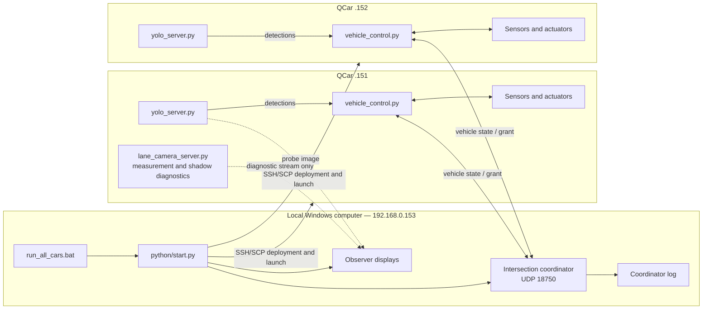
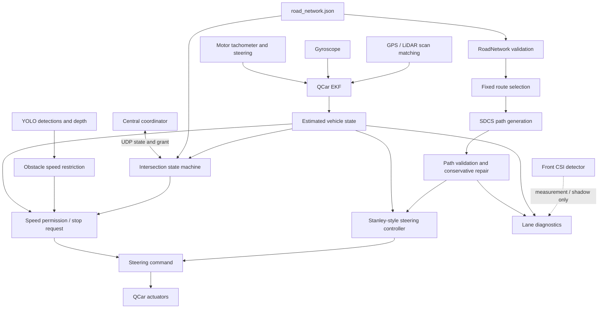
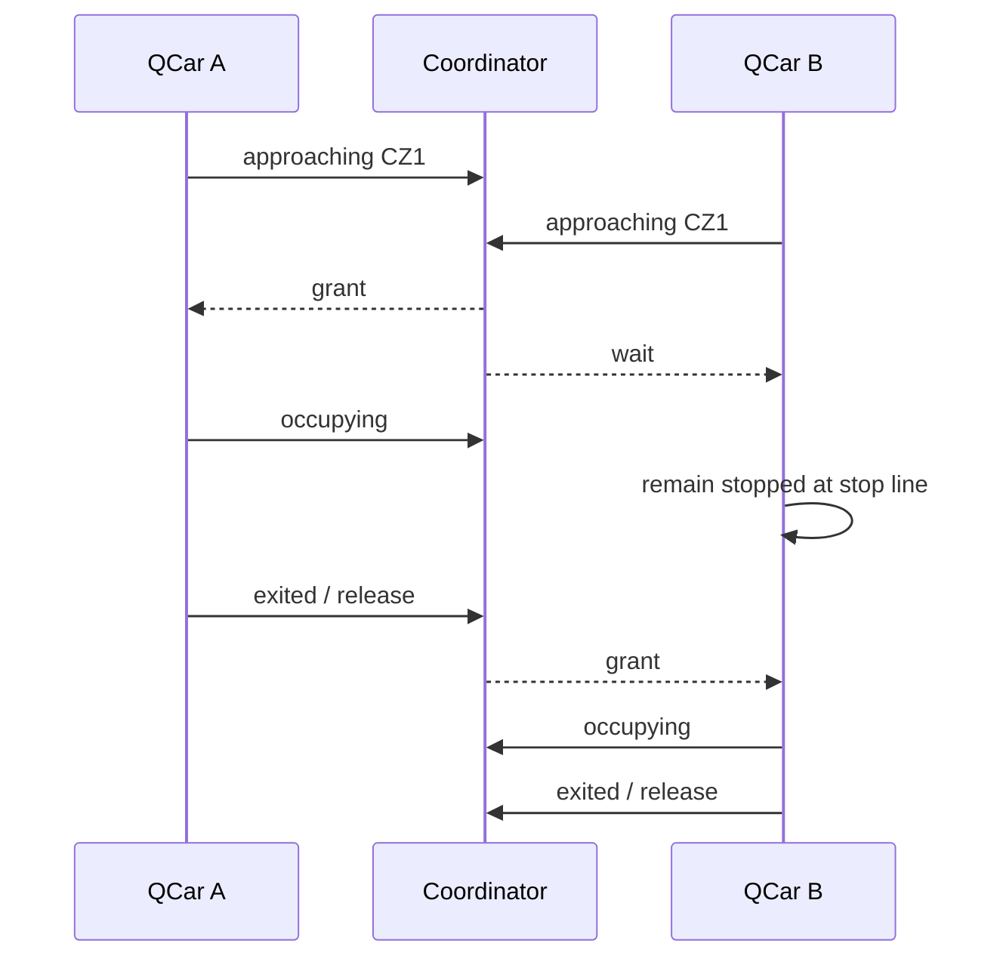
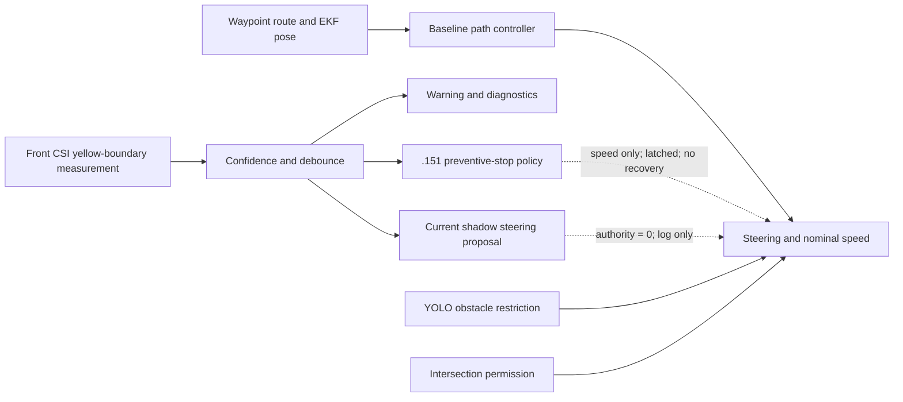

# System Architecture

Report-ready image: `docs/system_architecture.png`  
Standalone Mermaid source: `docs/system_architecture.mmd`

## Deployment view

The coordinator runs automatically on the local computer. It does not send
steering commands. It grants or denies permission to occupy a configured
conflict zone; each QCar retains responsibility for stopping and tracking its
route.

## Vehicle control and information flow

## CZ1 decision sequence

If the current owner becomes stale, the coordinator locks the zone instead of
granting it to another vehicle. If that same owner resumes communication, its
ownership can be restored without creating simultaneous ownership.

## Safety authority

Speed may be reduced to zero by the intersection state machine, YOLO obstacle
logic, stale-localization protection, or the tracking-loss guard in
`baseline_safety`. On `.151`, `preventive_stop` additionally permits calibrated
camera-boundary state to reduce speed and latch a stop without camera steering
authority. A reservation grant is permission to enter the conflict zone, not
permission to ignore an observed obstacle.

## Staged hybrid lane safety

Waypoint navigation remains responsible for route selection. The accepted
`hybrid_safety_2` experiment kept the entire car inside its lane by stopping,
but did not provide continuous route completion or automatic recovery.
Subsequent low-authority steering candidates still crossed the divider and are
disabled in the normal launcher. Camera processing therefore runs in shadow
mode while the lane-centering approach remains under investigation. It cannot
choose a route, grant an intersection movement, or override YOLO/CZ1 stopping.
